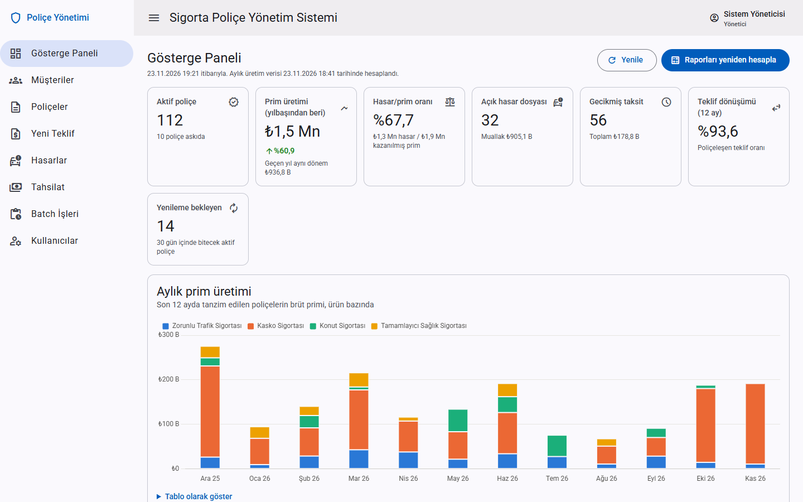
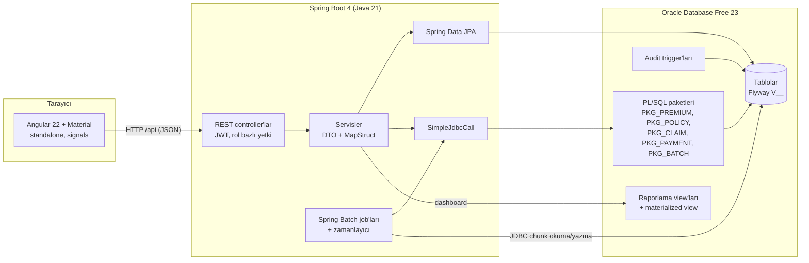
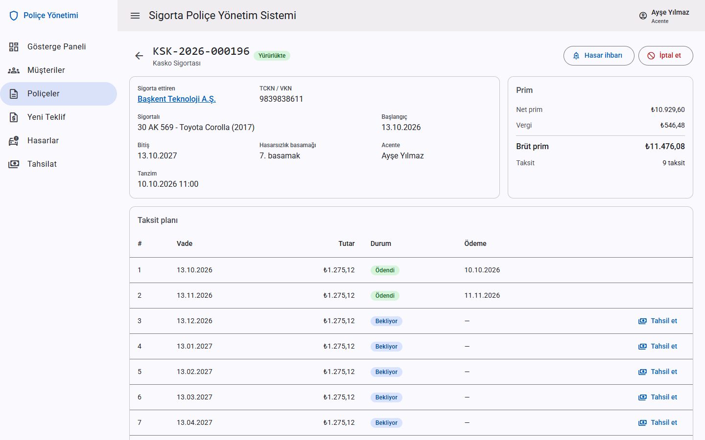
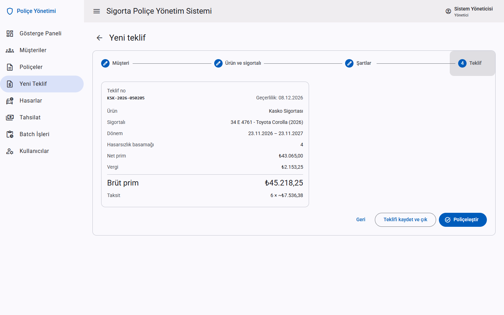
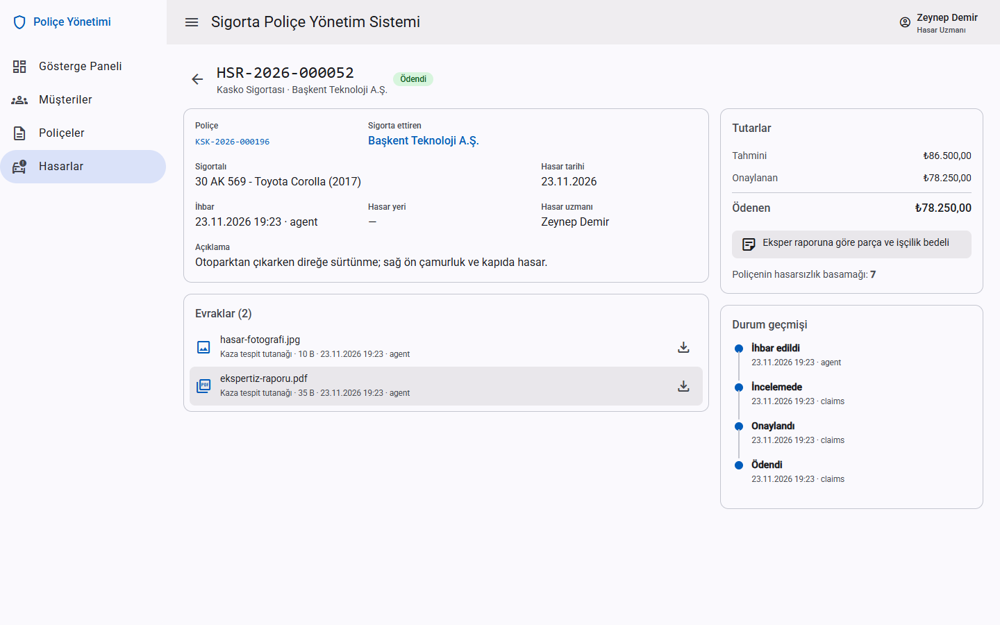
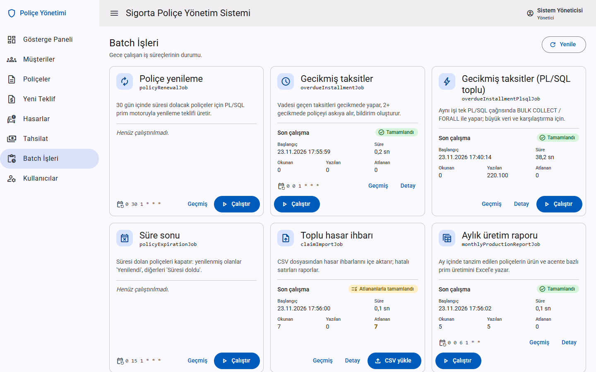

# Sigorta Poliçe Yönetim Sistemi

[](https://github.com/CeyDrew/insurance-policy-management/actions/workflows/ci.yml)

Sigorta sektörü için uçtan uca bir poliçe yönetim sistemi: müşteri ve varlık kaydı, teklif ve poliçeleştirme,
taksit tahsilatı, hasar ihbarından ödemeye hasar süreci, gece çalışan batch işleri ve raporlama. Portföy
projesidir; yalnızca lokal ortamda çalışır.

> **EN summary:** Insurance policy management system built with Spring Boot, Angular, Oracle PL/SQL and
> Spring Batch. Premium, refund and no-claims-discount rules live in PL/SQL packages called from Java,
> recurring business processes run as Spring Batch jobs with a monitoring screen, and an Angular Material
> panel drives the whole flow. Runs locally with a single `docker compose up --build`.



## Hızlı başlangıç (tek komut)

Gereken tek şey Docker Desktop (en az 6 GB bellek ayrılmış olmalı).

```bash
cp .env.example .env            # şifreleri ve JWT_SECRET'ı değiştir
docker compose up --build       # ilk açılış: Oracle ~2-3 dk, imaj build'leri ~3-5 dk
```

`JWT_SECRET` için rastgele bir değer üret:
`node -e "console.log(require('crypto').randomBytes(48).toString('base64'))"`
(veya `openssl rand -base64 48`).

| Adres | Açıklama |
|---|---|
| http://localhost:4200 | Yönetim paneli |
| http://localhost:4200/swagger-ui.html | API dokümantasyonu (login'den aldığın token'ı Authorize'a gir) |
| http://localhost:8080/actuator/health | Backend sağlık kontrolü |

Veritabanı şeması, PL/SQL paketleri ve demo verisi backend açılırken Flyway ile kurulur. Konteynerleri kapatmak
için `docker compose down`; veriyi de silmek için `docker compose down -v`.

### Demo kullanıcılar

Hepsinin şifresi `Demo123!` — giriş ekranında rol butonuna tıklayınca alanlar dolar.

| Kullanıcı | Rol | Ne yapabilir |
|---|---|---|
| `admin` | Yönetici | Her şey; kullanıcı yönetimi, batch işleri, rapor yenileme |
| `agent`, `agent2` | Acente | Müşteri, teklif, poliçe, hasar ihbarı, tahsilat |
| `claims` | Hasar uzmanı | Hasar dosyasını üstlenme, onay/red, ödeme |

## Özellikler

- **Müşteri ve varlıklar:** Bireysel/kurumsal müşteri (TCKN/VKN doğrulamalı), araç ve konut kaydı.
- **Teklif ve poliçe:** Trafik, kasko, konut, sağlık. Prim tarifeye göre PL/SQL'de hesaplanır; teklifte net
  prim, vergi, brüt prim ve hasarsızlık basamağı gösterilir. Teklif → poliçeleştirme → taksit planı; gün esaslı iade ile iptal.
- **Hasar süreci:** İhbar (teminat ve mükerrer kontrolü), evrak yükleme (PDF/JPEG/PNG, içerik doğrulamalı),
  hasar uzmanına atama, onay/red, ödeme. Ödenen trafik/kasko hasarı hasarsızlık basamağını düşürür ve açık
  yenileme teklifini yeniden fiyatlar. Durum geçmişi audit log'dan.
- **Tahsilat:** Gecikmiş taksit listesi, sıralı tahsilat; askıdaki poliçe son borç ödenince yeniden yürürlüğe girer.
- **Batch işleri (Spring Batch):** Gecikme işaretleme ve askıya alma, poliçe süresi dolumu, yenileme teklifi
  üretimi, CSV'den toplu hasar ihbarı, aylık Excel üretim raporu. İzleme ekranından başlatma, adım
  istatistikleri, hatalı satırlar, rapor indirme.
- **Banka tahsilat dosyaları:** Otomatik ödeme talimatlı taksitler için sabit uzunluklu talep dosyası üretimi,
  bankanın sonuç dosyasını trailer kontrolüyle doğrulama, satırları paralel bölümlerle PL/SQL'de uygulama
  (tahsil / red / hatalı), mükerrer dosya engeli, yarıda kalan işi kaldığı yerden sürdürme, `inbox/`
  klasörünü izleme. Demo için banka simülatörü. 1 milyon satırlık dosyayla ölçüldü. Format:
  [docs/bank-file-format.md](docs/bank-file-format.md)
- **Gösterge paneli:** KPI'lar, aylık prim üretimi, ürün bazında hasar/prim oranı, acente performansı.
  Oracle view'ları ve gece yenilenen materialized view'dan beslenir.
- **Güvenlik:** JWT access token + dönen refresh token, rol bazlı yetki (ekran ve API), RFC 7807 hata formatı.

## Mimari



- **İş kuralı ağırlıklı hesaplar PL/SQL'de**, Java servis katmanı bunları çağırır ve `ORA-200xx` hatalarını iş
  hatalarına çevirir. Ayrıntı: [docs/plsql.md](docs/plsql.md)
- **Backend feature bazlı paketlenir** (`customer`, `policy`, `premium`, `claim`, `payment`, `batch`, `report`...),
  her pakette Controller → Service → Repository. Entity'ler API'ye sızmaz.
- **Veritabanındaki her değişiklik Flyway ile:** tablolar `V__`, paket/trigger/view'lar `R__` (repeatable).
- Veritabanı şeması: [docs/er-diagram.md](docs/er-diagram.md) · Batch işleri ve performans ölçümü:
  [docs/batch-jobs.md](docs/batch-jobs.md)

### Karar kayıtları (ADR)

1. [Prim, iade ve hasarsızlık hesapları PL/SQL'de](docs/adr/0001-premium-calculation-in-plsql.md)
2. [Periyodik süreçler için Spring Batch](docs/adr/0002-spring-batch-for-recurring-processes.md)
3. [Feature bazlı paketleme](docs/adr/0003-feature-based-packaging.md)
4. [Kısa ömürlü JWT + dönen refresh token](docs/adr/0004-jwt-with-rotating-refresh-tokens.md)

## Teknik kapsam

| Alan | Projede nerede |
|---|---|
| **PL/SQL** | Prim/iade/hasarsızlık paketleri ([`R__2`](backend/src/main/resources/db/migration/R__2_pkg_premium.sql)–[`R__7`](backend/src/main/resources/db/migration/R__7_pkg_payment.sql)), audit trigger'ları (JSON), `BULK COLLECT`/`FORALL` ile toplu işlem ([`R__5`](backend/src/main/resources/db/migration/R__5_pkg_batch.sql)), raporlama view'ları ve materialized view ([`R__8`](backend/src/main/resources/db/migration/R__8_reporting_views.sql)), `JSON_TABLE` ile chunk başına tek çağrıda banka sonucu uygulama ([`R__9`](backend/src/main/resources/db/migration/R__9_pkg_collection.sql)) |
| **Java + Spring Boot** | REST API, Spring Security (JWT), JPA + MapStruct, `SimpleJdbcCall` ile PL/SQL entegrasyonu, ProblemDetail hata yönetimi, Testcontainers testleri |
| **Angular** | Standalone component'ler, signals/`rxResource`, reactive forms, interceptor ile token yenileme, rol bazlı route guard, Chart.js dashboard |
| **Batch süreçleri** | 8 Spring Batch job'ı (retry/skip, idempotent, restart), partitioning, sabit uzunluklu dosya okuma/yazma (`FixedLengthTokenizer`, `FormatterLineAggregator`, header/trailer callback), cron ve klasör izleme, izleme ekranı; 220 bin ve 1 milyon satırlık ölçümler |
| **Dokümantasyon ve süreç** | ADR'ler, ER diyagramı, PL/SQL ve batch dokümantasyonu, faz faz küçük commit geçmişi, CI |
| **Sigorta alan bilgisi** | Tarife bazlı prim, hasarsızlık basamağı, gün esaslı iade, kazanılmış prim, muallak hasar, hasar/prim oranı |

## Ekran görüntüleri

| | |
|---|---|
|  |  |
| Poliçe detayı: prim, taksit planı, tahsilat | Teklif: PL/SQL'de hesaplanan prim |
|  |  |
| Hasar dosyası: evrak, tutarlar, durum geçmişi | Batch izleme: adım istatistikleri |

## Geliştirme ortamı

Docker yerine lokal çalıştırmak için JDK 21+ ve Node.js 22+ gerekir (Maven gerekmez, `mvnw` gelir).

```bash
docker compose up -d --wait oracle   # sadece veritabanı

cd backend
./mvnw spring-boot:run               # Windows: mvnw.cmd spring-boot:run  ->  http://localhost:8080

cd frontend
npm install
npm start                            # http://localhost:4200 (API'yi 8080'e proxy'ler)
```

Backend, kök dizindeki `.env` dosyasını kendisi okur.

## Testler

```bash
cd backend && ./mvnw verify          # birim + entegrasyon; Testcontainers geçici bir Oracle açar (Docker gerekli)
cd frontend && npm test -- --watch=false
```

- Backend testleri gerçek Oracle'a karşı çalışır: PL/SQL paketleri, trigger'lar, view'lar, batch job'ları ve REST
  API uçtan uca test edilir. Kapsam raporu: `backend/target/site/jacoco/index.html`.
- GitHub Actions her push'ta backend testlerini, frontend testleri + build'i ve Docker imajlarını çalıştırır
  (deploy adımı yok).

## Proje yapısı

```
backend/     Spring Boot uygulaması (feature bazlı paketler, Flyway migration'ları, Dockerfile)
frontend/    Angular yönetim paneli (feature klasörleri, nginx.conf, Dockerfile)
docker/      Oracle init script'leri
docs/        ER diyagramı, PL/SQL ve batch dokümantasyonu, ADR'ler, örnek CSV, ekran görüntüleri
```
