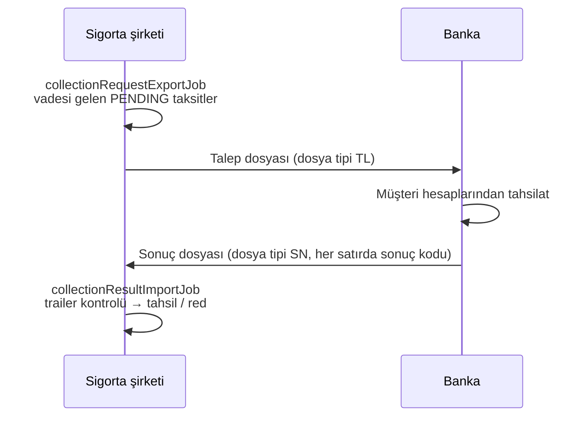

# Banka Tahsilat Dosyası Formatı (SPT-1)

Otomatik ödeme talimatlı (OTÖ) prim tahsilatı için şirket ile banka arasında alınıp verilen dosyanın formatı.
**Format kurgusaldır**, gerçek bir bankanın formatı değildir. Sektördeki tipik yapıyı izler: sabit uzunluklu
(positional) kayıtlar, başta bir header, sonda kontrol toplamlı bir trailer.

## Akış



Demo ortamında banka tarafı **banka simülatörü** ile taklit edilir: üretilmiş bir talep dosyasından, satırların
çoğu başarılı, bir kısmı redli bir sonuç dosyası oluşturur (tahsilat dosyaları ekranı → "Banka cevabı üret").

## Genel kurallar

- Her satır **120 karakter**, satır sonu `LF`. Karakter seti ASCII.
- Sayısal alanlar sağa dayalı, soldan sıfır dolgulu. Metin alanları sola dayalı, sağdan boşluk dolgulu.
- Tutarlar **kuruş** cinsinden tam sayıdır (`1.275,12 TL` → `000000000127512`).
- Tarihler `yyyyMMdd`.
- Dosya tam olarak bir header (`H`), en az sıfır detay (`D`) ve bir trailer (`T`) kaydından oluşur.

## Header — `H`

| Konum | Uzunluk | Alan | Açıklama |
|---|---|---|---|
| 1 | 1 | Kayıt tipi | `H` |
| 2–5 | 4 | Banka kodu | Kurgusal: `0099` |
| 6–13 | 8 | Dosya tarihi | `yyyyMMdd` |
| 14–23 | 10 | Dosya numarası | Talep dosyasının numarası; sonuç dosyası aynı numarayı taşır |
| 24–25 | 2 | Dosya tipi | `TL` talep, `SN` sonuç |
| 26–45 | 20 | Gönderen kodu | `SIGORTA-DEMO` |
| 46–120 | 75 | Dolgu | Boşluk |

## Detay — `D`

| Konum | Uzunluk | Alan | Açıklama |
|---|---|---|---|
| 1 | 1 | Kayıt tipi | `D` |
| 2–11 | 10 | Sıra no | Dosya içindeki detay sırası, 1'den başlar |
| 12–21 | 10 | Taksit referansı | Şirketin taksit numarası (id) |
| 22–41 | 20 | Poliçe no | Örn. `KSK-2026-000196` |
| 42–43 | 2 | Taksit no | 1–12 |
| 44–51 | 8 | Vade tarihi | `yyyyMMdd` |
| 52–66 | 15 | Tutar | Kuruş |
| 67–68 | 2 | Sonuç kodu | Talepte boşluk; sonuçta aşağıdaki kodlardan biri |
| 69–120 | 52 | Dolgu | Boşluk |

### Sonuç kodları

| Kod | Anlamı | Sistemdeki karşılığı |
|---|---|---|
| `00` | Tahsil edildi | Taksit `PKG_PAYMENT` üzerinden `DIRECT_DEBIT` ile ödenir, müşteriye "Ödemeniz alındı" bildirimi |
| `51` | Yetersiz bakiye | Taksit üzerinde red kodu işaretlenir, müşteriye bildirim, sonraki talep dosyasına tekrar girer |
| `54` | Hesap kapalı | Aynı |
| `57` | Talimat bulunamadı / iptal | Aynı |
| `91` | Banka sistem hatası | Aynı (müşteriye "tekrar denenecek" bilgisi) |

Kod tablosu dışındaki bir değer, eşleşmeyen taksit referansı veya poliçe/taksit no/tutar uyuşmazlığı satırı
**hatalı** sayar: o satır işlenmez, sonuç listesinde sebebiyle görünür.

## Trailer — `T`

| Konum | Uzunluk | Alan | Açıklama |
|---|---|---|---|
| 1 | 1 | Kayıt tipi | `T` |
| 2–11 | 10 | Kayıt sayısı | Detay kaydı sayısı |
| 12–29 | 18 | Toplam tutar | Tüm detay tutarlarının toplamı, kuruş |
| 30–120 | 91 | Dolgu | Boşluk |

**Kontrol:** Sonuç dosyasında trailer'daki kayıt sayısı veya toplam tutar detaylarla tutmazsa dosya bütünüyle
reddedilir. Job `FAILED` olur ve **hiçbir satır işlenmez**. Bozuk ya da eksik aktarılmış bir dosyanın yarısının
uygulanmasını önlemek için kontrol, uygulama adımından önce ayrı bir adımda yapılır.

## Örnek

Uygulamanın ürettiği bir talep dosyası (sağdaki boşluk dolguları kısaltılmıştır):

```
H0099202611230000000001TLSIGORTA-DEMO
D00000000010000000016KNT-2026-000005     0120260803000000000446473
D00000000020000000028KSK-2026-000008     0920261125000000000318780
...
T0000000062000000000019847065
```

Bankanın döndürdüğü sonuç dosyasında header'ın dosya tipi `SN` olur ve her detayın 67–68. karakterlerine sonuç
kodu yazılır:

```
H0099202611230000000001SNSIGORTA-DEMO
D00000000010000000016KNT-2026-000005     012026080300000000044647300
D00000000020000000028KSK-2026-000008     092026112500000000031878000
```
## Tekrar ve mükerrerlik

- Aynı sonuç dosyası (aynı içerik → aynı SHA-256) ikinci kez yüklenirse reddedilir. Başarısız olmuş
  (trailer hatalı) bir dosyanın düzeltilmiş hali farklı hash'e sahip olduğu için yüklenebilir.
- Yarıda kesilen bir içe aktarma yeniden başlatıldığında, commit edilmiş chunk'lar tekrar işlenmez. Ayrıca
  PL/SQL tarafı aynı dosya satırını ikinci kez uygulamaz (`COLLECTION_RESULT` benzersizliği), yani çift tahsilat
  oluşmaz.
