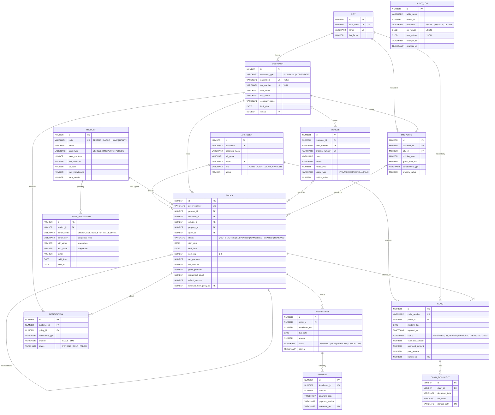

# Veritabanı Şeması (ER Diyagramı)

Şema tamamen Flyway migration'ları ile yönetilir: `backend/src/main/resources/db/migration`.

`AUDIT_LOG` bilinçli olarak FK içermez: silinen kayıtların izi de korunur. Faz 4'te poliçe ve hasar tablolarındaki trigger'lar bu tabloyu doldurur.

## Tasarım kararları

- **Anahtarlar:** Her tablonun `NUMBER(19)` surrogate PK'sı kendi sequence'ından `DEFAULT seq.NEXTVAL` ile beslenir. İş anahtarları (`policy_number`, `claim_number`, `plate_number`, TCKN/VKN) ayrıca `UNIQUE` kısıtlıdır.
- **Ortak kolonlar:** `created_at/by`, `updated_at/by` (auditing) ve `version` (JPA optimistic locking).
- **Oracle 19c uyumu:** Boolean alanlar `NUMBER(1)` + `CHECK (x IN (0,1))`. 23ai'ye özgü söz dizimi kullanılmadı; sigorta şirketlerinde yaygın sürümlerde de çalışır.
- **Teklif = poliçe:** Teklif ayrı tablo değildir; `QUOTE` durumundaki poliçedir. Poliçeleştirme durum geçişiyle olur, numara ve geçmiş korunur.
- **Yenileme zinciri:** `renewed_from_policy_id` ile eski dönem poliçeye bağlanır; eski poliçe `RENEWED` olur.
- **Hasarsızlık basamağı (NCD):** 1-8 arası, giriş basamağı 4. Katsayılar `TARIFF_PARAMETER` içinde (`NCD_STEP`).
- **Tarife tablosu:** Tek, generic bir tablo. Bir satır ya sayısal aralıktır (`min_value..max_value`, örn. sürücü yaşı) ya da kategorik anahtardır (`param_key`, örn. kullanım tipi). `valid_from/valid_to` ile tarife versiyonlanabilir. Faz 4'teki `PKG_PREMIUM` bu tabloyu okur.
- **Kısıtlar veritabanında:** Durum değerleri, tutar işaretleri, tarih sırası, TCKN/VKN biçimi, "iptal edilen poliçede iptal nedeni zorunlu", "ödenen taksitte ödeme zamanı zorunlu" gibi kurallar `CHECK` ile korunur. Uygulama katmanı atlansa bile veri tutarlı kalır.
- **Batch için indeksler:** `policy (status, end_date)` yenileme/süre sonu job'ları, `installment (status, due_date)` gecikme job'u için.

## Seed verisi

| Migration | İçerik |
|---|---|
| `V6__seed_reference_data` | 81 il (risk katsayısıyla), 4 ürün, tarife parametreleri, demo kullanıcılar |
| `V7__seed_demo_data` | 50 müşteri (42 bireysel, 8 kurumsal), araç/konutlar, 200 poliçe, taksit planları, tahsilatlar, hasarlar |

`V7` bir PL/SQL bloğudur; `DBMS_RANDOM` sabit seed ile çalışır, bu yüzden her temiz kurulumda aynı veri oluşur. Tarihler migration anına göre hesaplanır. Böylece süresi 30 gün içinde dolacak poliçeler ve vadesi geçmiş taksitler her zaman bulunur (Faz 5 batch demoları). TCKN/VKN değerleri geçerli kontrol hanesiyle üretilir.

Demo kullanıcılar (şifre: `Demo123!`): `admin` (ADMIN), `agent` ve `agent2` (AGENT), `claims` (CLAIM_HANDLER).
