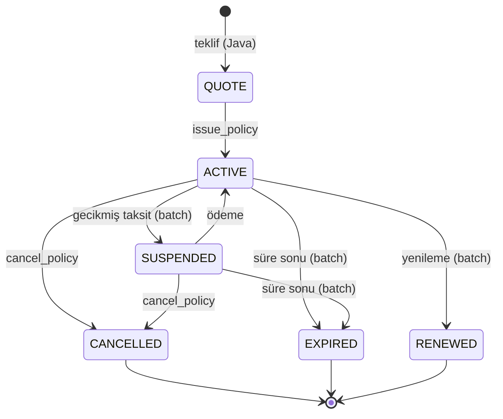
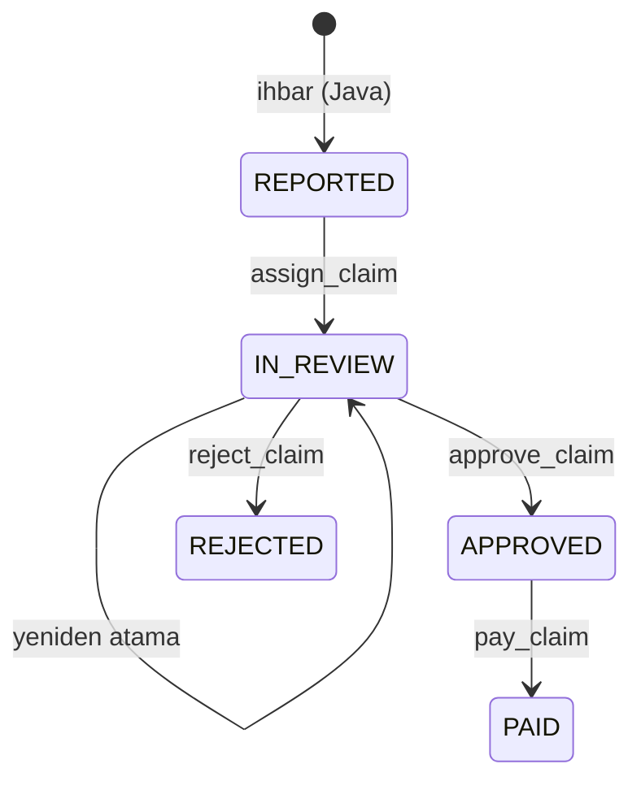

# PL/SQL Bileşenleri

Prim hesabı, taksit planı, poliçe durum geçişleri ve iptal iadesi veritabanında, PL/SQL paketlerinde çalışır.
Java servis katmanı bu kuralları yeniden yazmaz; paketleri `SimpleJdbcCall` ile çağırır.

| Bileşen | Migration | Görevi |
|---|---|---|
| `PKG_ERRORS` | `R__1_pkg_errors.sql` | Kodlu uygulama hataları (`RAISE_APPLICATION_ERROR`) |
| `PKG_PREMIUM` | `R__2_pkg_premium.sql` | Tarifeye göre prim hesabı, taksit planı |
| `PKG_POLICY` | `R__3_pkg_policy.sql` | Durum geçişleri, poliçeleştirme, gün esaslı iade ve iptal |
| `TRG_POLICY_AUDIT`, `TRG_CLAIM_AUDIT` | `R__4_audit_triggers.sql` | Değişiklikleri `AUDIT_LOG`'a JSON olarak yazar |
| `PKG_BATCH` | `R__5_pkg_batch.sql` | Büyük hacim için set-based gecikme işaretleme (`BULK COLLECT` / `FORALL`) |
| `PKG_CLAIM` | `R__6_pkg_claim.sql` | Hasar durum akışı, ödeme ve hasarsızlık basamağı güncellemesi |
| `PKG_PAYMENT` | `R__7_pkg_payment.sql` | Taksit tahsilatı ve askıdaki poliçenin yeniden yürürlüğe girmesi |
| Raporlama view'ları, `PKG_REPORTING` | `R__8_reporting_views.sql` | Dashboard: kazanılmış prim, hasar/prim oranı, acente performansı, aylık üretim |
| `PKG_COLLECTION` | `R__9_pkg_collection.sql` | Banka tahsilat sonuç dosyasının satırlarını uygular (tahsil / red / hatalı) |

Paket ve trigger'lar Flyway **repeatable** (`R__`) migration'larıdır: dosya değiştiğinde bir sonraki açılışta
yeniden derlenir. Tablolar ise sürümlü (`V__`) migration'lardadır.

## Neden PL/SQL?

- **Tek kaynak:** Tarife ve iade kuralları, veriyi kim değiştirirse değiştirsin (REST API, batch job,
  veritabanından yapılan düzeltme) aynı yerden uygulanır.
- **Veriye yakınlık:** Prim hesabı müşteri, araç/konut, il ve tarife tablolarını okur. Bu iş tek bir veritabanı
  çağrısında biter; Java'ya taşınacak bir nesne grafiği yoktur.
- **Tutarlılık:** Poliçe satırı `SELECT ... FOR UPDATE` ile kilitlenir. Durum değişikliği, taksit planı ve
  iadeler aynı transaction'da atomik olarak yapılır.
- **Sektör gerçeği:** Sigorta çekirdek sistemlerinde tarife motorunun PL/SQL'de olması yaygındır. Uygulama katmanı
  bunu bir arayüzün (`PremiumEngine`, `PolicyLifecycle`) arkasında soyutlar.

## PKG_PREMIUM

### Prim formülü

Bütün katsayılar `TARIFF_PARAMETER` tablosundan, poliçe başlangıç tarihinde geçerli olan satırdan okunur.

| Ürün | Net prim |
|---|---|
| Trafik | `base_premium` × il riski × sürücü yaşı × araç yaşı × kullanım tipi × hasarsızlık basamağı |
| Kasko | araç değeri × `VALUE_RATE` × il riski × sürücü yaşı × araç yaşı × kullanım tipi × hasarsızlık basamağı |
| Konut | konut değeri × `VALUE_RATE` × konutun ilinin riski × bina yaşı × yapı tipi |
| Sağlık | `base_premium` × sigortalı yaşı |

- Sonuç ürünün `min_premium` değerinin altına düşmez. Tutar 2 haneye yuvarlanır (Oracle `ROUND`, yarım yukarı).
- Vergi `net × tax_rate`, brüt prim `net + vergi`.
- Kurumsal müşterinin doğum tarihi yoktur; sürücü yaşı katsayısı uygulanmaz.
- Araç/bina yaşı negatif çıkarsa (gelecek model yılı) 0 kabul edilir.

**Örnek (Trafik):** İstanbul'da (1,35) oturan 37 yaşında (1,00) bir sürücünün 6 yaşındaki (1,05) hususi (1,00)
aracı, 4. basamakta (1,00):
`4.500 × 1,35 × 1,00 × 1,05 × 1,00 × 1,00 = 6.378,75 ₺ net`, `318,94 ₺ vergi`, `6.697,69 ₺ brüt`.
Bu ve benzeri örnekler `PremiumPackageTest` içinde birebir test edilir.

### Tarife tablosu

`TARIFF_PARAMETER` tek ve generic bir tablodur. Bir satır iki şekilden birindedir:

- **Aralık:** `min_value..max_value` (dahil). Örnek: `DRIVER_AGE 18..25 → 1,40`.
- **Kategori:** `param_key`. Örnek: `USAGE_TYPE TAXI → 1,60`.

`valid_from` / `valid_to` sayesinde tarife versiyonlanabilir. Yeni tarife eklemek için kod değişikliği gerekmez.

### API

```sql
-- Net prim (SQL'den de çağrılabilir)
SELECT pkg_premium.calculate_premium('CASCO', :customer_id, :vehicle_id, NULL, 4, DATE '2026-06-01') FROM dual;

-- Uygulamanın kullandığı giriş noktası: net, vergi, brüt (OUT parametreleri)
pkg_premium.calculate(p_product_code, p_customer_id, p_vehicle_id, p_property_id, p_ncd_step, p_start_date,
                      p_net_premium, p_tax_amount, p_gross_premium);

-- Taksit planı: eşit aylık taksitler, kuruş farkı son taksitte. FORALL ile toplu insert.
pkg_premium.generate_installments(p_policy_id, p_count DEFAULT NULL, p_created_by DEFAULT 'system');
```

## PKG_POLICY



| Prosedür | Ne yapar |
|---|---|
| `is_allowed_transition(from, to)` | Geçiş matrisi; 1/0 döner, SQL'den kullanılabilir |
| `change_status(id, status, user)` | Genel durum değişikliği (batch job'lar için) |
| `issue_policy(id, user)` | Teklifi doğrular (geçerlilik, başlangıç tarihi, çakışan poliçe), `ACTIVE` yapar, taksit planı üretir |
| `calculate_refund(id, date)` | `brüt prim × kullanılmayan gün / toplam gün` |
| `cancel_policy(id, reason, date, user, OUT refund)` | İadeyi hesaplar, poliçeyi `CANCELLED` yapar, ödenmemiş taksitleri iptal eder |

Bütün güncellemeler `updated_at`, `updated_by` ve `version` kolonlarını da günceller. Böylece JPA'nın optimistic
locking'i ve audit kayıtları PL/SQL değişikliklerini de görür.

## PKG_CLAIM



- Dosyayı sadece **atanmış hasar uzmanı** (veya ADMIN) onaylayabilir, reddedebilir ve ödeyebilir
  (`NOT_ASSIGNED_HANDLER`).
- Dosya sadece aktif bir `CLAIM_HANDLER` veya `ADMIN` kullanıcısına atanabilir. Red gerekçesi zorunludur.
- Her durum değişikliğinde müşteriye `CLAIM_STATUS_CHANGED` bildirimi yazılır.
- **`apply_paid_claim_to_ncd`:** Trafik/kasko hasarı ödendiğinde poliçenin hasarsızlık basamağı bir düşer (en az 1).
  Bu poliçenin henüz poliçeleşmemiş yenileme teklifleri de yeni basamakla `PKG_PREMIUM.CALCULATE` üzerinden yeniden
  fiyatlanır. Bu yüzden `PKG_POLICY.NEXT_NCD_STEP`, hasarlı bir dönemde basamağı ikinci kez düşürmez; hasarsız
  dönemde bir artırır.

## PKG_PAYMENT

`pay_installment(installment_id, method, paid_by, OUT payment_id, OUT reactivated)`

- Taksitler sırayla ödenir: önce daha eski vadeli ödenmemiş taksit tahsil edilmelidir (`EARLIER_INSTALLMENT_UNPAID`).
- Ödenmiş veya iptal edilmiş taksit tahsil edilemez. Tahsilat referansı `TAH-yyyyMMdd-<id>` biçimindedir.
- Askıdaki (`SUSPENDED`) poliçenin son gecikmiş taksiti ödenince poliçe `PKG_POLICY.CHANGE_STATUS` ile tekrar
  `ACTIVE` olur ve `reactivated = 1` döner. Müşteriye `PAYMENT_RECEIVED` bildirimi yazılır.

`collect_direct_debit(installment_id, reference, paid_by, OUT payment_id)` bankanın otomatik ödeme talimatıyla
çektiği tutarı `DIRECT_DEBIT` olarak işler. Gişe tahsilatından farkı, taksit sırası kuralının uygulanmamasıdır:
para banka hesabından çıkmıştır, kaydedilmesi gerekir. Ortak kısım (taksit, ödeme kaydı, bildirim, askıdan
çıkarma) iki prosedürün de kullandığı `apply_payment` içindedir.

## PKG_COLLECTION

`apply_results(file_id, lines CLOB, applied_by)`, `collectionResultImportJob`'ın her chunk'ını tek çağrıda alır.
Satırlar bir JSON dizisi olarak gelir, `JSON_TABLE` ile `T_BANK_RESULT_TAB` koleksiyonuna açılır.

| Satır | Sonuç |
|---|---|
| Kod `00`, taksit açık | `PKG_PAYMENT.COLLECT_DIRECT_DEBIT`, referans `OTO-<dosya>-<satır>`, sonuç `COLLECTED` |
| Kod `51` / `54` / `57` / `91` | Taksite red kodu yazılır, talep bağlantısı kaldırılır (bir sonraki talep dosyasına tekrar girer), müşteriye `COLLECTION_REJECTED` bildirimi, sonuç `REJECTED` |
| Bilinmeyen taksit, poliçe/taksit no veya tutar uyuşmazlığı, geçersiz kod, zaten ödenmiş veya iptal edilmiş taksit | Taksite dokunulmaz, sebep `COLLECTION_RESULT.MESSAGE`'a yazılır, sonuç `ERROR` |

- **Tekrar uygulanmaz:** Aynı dosyanın aynı satırı için `COLLECTION_RESULT` kaydı varsa satır atlanır
  (`UK_COLLECTION_RESULT_LINE` ile de korunur). Yarıda kesilip yeniden başlatılan bir job çift tahsilat üretmez.
- **Sayaçlar sonda:** Tahsil, red ve hatalı sayıları ile tahsil edilen tutar `complete_file` ile
  `COLLECTION_RESULT`'tan hesaplanır. Paralel partition'lar aynı `COLLECTION_FILE` satırını her chunk'ta
  güncelleyip birbirini kilitlemez.
- **Mükerrer dosya:** `UX_COLLECTION_FILE_HASH` fonksiyon tabanlı unique index'tir. Başarısız olmamış gelen
  dosyalarda aynı SHA-256'nın ikinci kez kaydedilmesini engeller. Reddedilen (trailer hatalı) bir dosya engel
  olmaz, düzeltilmiş hali yüklenebilir.

> Satırlar ilk denemede Oracle nesne tipi (`T_BANK_RESULT`) olarak JDBC'nin `createStruct` /
> `createOracleArray` API'siyle gönderiliyordu. Testcontainers'daki slim Oracle imajında sürücü tip tanımını
> çözemedi ve bağlantılar koptu. JSON + `JSON_TABLE` aynı tek round-trip'i sürücüye özel API olmadan sağlıyor;
> tutarlar JSON number olduğu için oturumun NLS ayarından (ondalık ayracı) da etkilenmiyor.

## Raporlama

| Nesne | Ne verir |
|---|---|
| `V_POLICY_EARNED` | Poliçe başına kazanılmış prim: geçen gün / poliçe süresi oranında. İptal edilen poliçede iade edilmeyen kısım. |
| `V_POLICY_INCURRED` | Poliçe başına ödenen hasar ve muallak (onaylıysa onaylanan, incelemedeyse tahmini tutar) |
| `V_LOSS_RATIO_BY_PRODUCT` | Ürün bazında hasar/prim oranı = (ödenen + muallak) / kazanılmış prim |
| `V_AGENT_PERFORMANCE` | Acente başına teklif, poliçe, dönüşüm oranı, yazılan prim, iptal ve hasar/prim oranı |
| `MV_PREMIUM_PRODUCTION_MONTHLY` | Ay × ürün prim üretimi. Materialized view: bir kez hesaplanır, `REFRESH COMPLETE ON DEMAND`. |

Materialized view `PKG_REPORTING.REFRESH_DASHBOARD` ile yeniden hesaplanır: her gece (`dashboardRefresh` cron,
batch zamanlamasıyla birlikte açılır) ya da yöneticinin dashboard'daki "Raporları yeniden hesapla" butonuyla.
Materialized view için `CREATE OR REPLACE` olmadığı için repeatable migration onu önce silip yeniden oluşturur.

Hasar/prim oranı yazılan değil **kazanılmış** prim üzerinden hesaplanır: yılın ortasında yazılan bir poliçenin
priminin henüz yarısı "kazanılmış"tır, oranı yazılan prime bölmek riskli ürünleri olduğundan iyi gösterir.

## Saat dilimi

PL/SQL'deki `SYSTIMESTAMP`/`SYSDATE` ve kolon varsayılanları veritabanı sunucusunun saat dilimini kullanır, Java ise
JVM'in saat dilimiyle yazar. İkisi farklıysa aynı işlemin zamanları ekranda saatlerce kayar. Bu yüzden Oracle
konteyneri `TZ=Europe/Istanbul` ile çalışır (`docker-compose.yml`, `ORACLE_TZ`). Testcontainers da JVM'in saat
dilimiyle başlatılır.

## Hata yönetimi

PL/SQL hataları tek formatta fırlatılır:

```
RAISE_APPLICATION_ERROR(-20004, 'POLICY_NOT_QUOTE|Sadece teklif durumundaki kayıtlar poliçeleştirilebilir.')
```

| Numara | Anlamı | API cevabı |
|---|---|---|
| -20001 | Kayıt bulunamadı (`POLICY_NOT_FOUND`, `CUSTOMER_NOT_FOUND`...) | 404 |
| -20002 | Doğrulama (`VEHICLE_REQUIRED`, `QUOTE_EXPIRED`, `INVALID_CANCEL_DATE`...) | 422 |
| -20003 | Tarife bulunamadı (`TARIFF_NOT_FOUND`) | 422 |
| -20004 | Geçersiz durum (`POLICY_NOT_QUOTE`, `INVALID_STATUS_TRANSITION`...) | 422 |

Java tarafında `PlsqlErrors` mesajı ayrıştırır ve `BusinessException(code, message)` üretir. Sonuç RFC 7807
`ProblemDetail` olarak döner:

```json
{ "status": 422, "title": "İş kuralı ihlali", "code": "TARIFF_NOT_FOUND",
  "detail": "Sürücü yaşı (17) için tarife bulunmuyor." }
```

Java servis katmanı bazı kontrolleri (araç sahibi, ürün-varlık uyumu) önceden yapar; kullanıcıya erken ve net hata
vermek içindir. PL/SQL aynı kontrolleri tekrar yapar ve son sözü söyler.

## Audit trigger'ları

`POLICY` ve `CLAIM` tablolarındaki her `INSERT/UPDATE/DELETE` için `AUDIT_LOG`'a bir satır yazılır:

| Kolon | İçerik |
|---|---|
| `old_values` / `new_values` | İlgili kolonların JSON görüntüsü (`JSON_OBJECT ... RETURNING CLOB`) |
| `changed_by` | Satırın `updated_by` / `created_by` değeri; silmede veritabanı oturum kullanıcısı |

```sql
SELECT changed_at, changed_by,
       JSON_VALUE(old_values, '$.status') AS old_status,
       JSON_VALUE(new_values, '$.status') AS new_status
  FROM audit_log
 WHERE table_name = 'POLICY' AND record_id = :id
 ORDER BY id;
```

## Java entegrasyonu

```
PolicyService ──► PremiumEngine   ──► PlsqlPremiumEngine   ──► PKG_PREMIUM.CALCULATE
              └─► PolicyLifecycle ──► PlsqlPolicyLifecycle ──► PKG_POLICY.ISSUE_POLICY / CANCEL_POLICY
```

- `SimpleJdbcCall` parametreleri açıkça tanımlanır (`withoutProcedureColumnMetaDataAccess`). Çağrı açılışta bir
  kez derlenir, veri sözlüğüne erişim gerekmez.
- PL/SQL, Hibernate'in henüz yazmadığı satırları göremez. JDBC çağrıları da Hibernate'in otomatik flush'ını
  tetiklemez. Bu yüzden `PolicyService` PL/SQL'den önce `flush()` yapar. Satırları değiştiren çağrılardan sonra
  da persistence context'i temizler (`clear()`), böylece eski entity dönmez.

## Testler

| Test | Kapsam |
|---|---|
| `PremiumPackageTest` | Elle hesaplanmış örneklerle bütün ürünler, minimum prim, kurumsal müşteri, tarife dışı yaş, geçersiz girdiler |
| `PolicyPackageTest` | Geçiş matrisi, poliçeleştirme ve taksit planı, gün esaslı iade, iptal, audit trigger'ı |
| `DatabaseMigrationTest` | Bütün paket ve trigger'ların hatasız derlendiği (`USER_ERRORS` boş, `INVALID` nesne yok) |
| `PlsqlErrorsTest` | ORA-20xxx mesajlarının API hatalarına çevrilmesi |

Son test önemlidir: Oracle derleme hatasını uyarı olarak bildirir ("created with compilation errors"). Yani Flyway,
bozuk bir paketle de başarılı bitebilir. Bu test o durumu yakalar.
